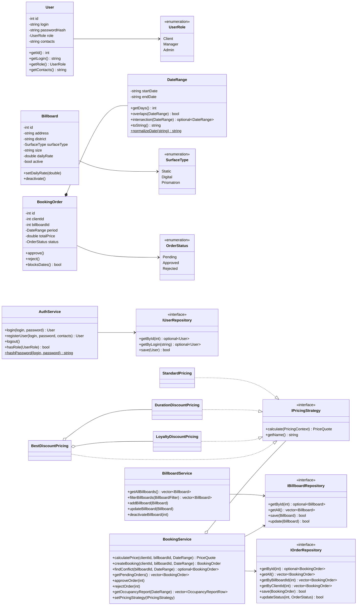

# Core / Domain — бизнес-логика AdBoard

Раздел пояснительной записки Разработчика №1. Модуль `include/domain`, `include/service`, `src/domain`, `src/service`
не зависит ни от SQLite, ни от консоли: с хранилищем он работает только через интерфейсы репозиториев,
а интерфейс пользователя вызывает его сервисы.

## 1. Диаграмма классов



Реализации репозиториев (`SqliteUserRepository` и др.) находятся в модуле Infrastructure и на диаграмме ядра
не показаны: ядро знает только интерфейсы (принцип инверсии зависимостей, DIP).

## 2. Паттерн Strategy для расчёта цены

**Проблема.** Правила ценообразования агентства меняются: сегодня скидка за длительность, завтра — для постоянных
клиентов, в праздники — акция. Если зашить их в `BookingService` цепочкой `if`, каждое изменение тарифа
потребует правки сервиса бронирования и повторного тестирования всей логики заявок.

**Решение.** Алгоритм расчёта вынесен в интерфейс `IPricingStrategy` с единственным методом
`calculate(PricingContext) -> PriceQuote`. `BookingService` хранит указатель на стратегию и вызывает её,
не зная, какая именно реализация подставлена.

| Стратегия | Правило |
|---|---|
| `StandardPricing` | `ставка × дни`, без скидок |
| `DurationDiscountPricing` | от 7 суток −5%, от 14 −10%, от 30 −15% |
| `LoyaltyDiscountPricing` | −10%, если у клиента ≥ 3 одобренных заказов |
| `BestDiscountPricing` (по умолчанию) | выбирает наибольшую из двух скидок выше, скидки не суммируются |

**Что это даёт:**
* *Open/Closed:* новый тариф — новый класс, `BookingService` не меняется.
* *Single Responsibility:* сервис отвечает за бронирование, стратегия — только за деньги.
* Стратегию можно заменить во время работы: `bookingService.setPricingStrategy(std::make_shared<StandardPricing>())`.
* Каждую стратегию легко протестировать отдельно, передав `PricingContext` вручную.

Результат расчёта `PriceQuote` содержит всё для блока «Расчёт» в интерфейсе: длительность, базовую стоимость,
процент и сумму скидки, её название и итог. Суммы округляются до копеек.

## 3. Алгоритм проверки пересечения интервалов

Период аренды — замкнутый отрезок дат `[s; e]`, обе границы входят в аренду (`DateRange::getDays() = e − s + 1`).

Два периода `A = [s₁; e₁]` и `B = [s₂; e₂]` **пересекаются** тогда и только тогда, когда

```
s₁ ≤ e₂  и  s₂ ≤ e₁
```

**Обоснование.** Периоды *не* пересекаются ровно в двух случаях: `A` целиком раньше `B` (`e₁ < s₂`) или `A`
целиком позже `B` (`e₂ < s₁`). Отрицание `¬(e₁ < s₂ ∨ e₂ < s₁)` по закону де Моргана даёт `s₂ ≤ e₁ ∧ s₁ ≤ e₂`.
Формула покрывает все варианты: частичное наложение слева и справа, вложение одного периода в другой
и совпадение одного граничного дня (в этот день щит уже занят, поэтому это тоже конфликт).

Общая часть периодов (`DateRange::intersection`) — `[max(s₁, s₂); min(e₁, e₂)]`; она используется в отчёте
менеджера для подсчёта занятых дней внутри выбранного месяца.

**Сравнение дат.** Даты хранятся в формате ISO `ГГГГ-ММ-ДД`: при фиксированной ширине полей лексикографический
порядок строк совпадает с хронологическим, поэтому сравнение выполняется за O(1) без разбора даты.
Количество дней считается переводом даты в номер дня от 1970-01-01 (алгоритм *days_from_civil*), что корректно
учитывает високосные годы и переходы через месяц и год.

**Применение в `BookingService`:**
1. Даты щита блокируют только заказы в статусе `Approved` (`BookingOrder::blocksDates()`).
2. `createBooking` перебирает заказы щита (`getByBillboardId`) — O(n) — и при конфликте отказывает с сообщением
   *«Щит #12 уже занят с 08.10.2026 по 15.10.2026»*.
3. `approveOrder` повторяет проверку: пока заявка ждала рассмотрения, те же даты могли одобрить другому клиенту.
   Так два пересекающихся заказа никогда не окажутся одобренными одновременно.

## 4. Правила домена

| Правило | Где реализовано |
|---|---|
| Дата существует (учёт високосных лет), формат ГГГГ-ММ-ДД или ДД.ММ.ГГГГ | `DateRange::normalizeDate` |
| Дата окончания не раньше даты начала | конструктор `DateRange` |
| Адрес и район не пустые, ставка > 0 | `Billboard` |
| Списанный щит не показывается в каталоге и не бронируется | `BillboardService`, `BookingService` |
| Решение по заявке принимается один раз, только из `Pending` | `BookingOrder::approve/reject` |
| Логин 3–32 символа (латиница, цифры, `_`, `.`) и уникален; пароль ≥ 4 символов без пробелов | `AuthService` |
| Пароль хранится только в виде хеша (FNV-1a 64 бит, логин — соль) | `AuthService::hashPassword` |

Хеши для тестовых пользователей в `data/schema.sql` (логин = пароль):

| Логин / пароль | `password_hash` |
|---|---|
| `admin` / `admin` | `68577352b08d4449` |
| `manager` / `manager` | `8e07a345d1f73659` |
| `client` / `client` | `1240781ba5c634cb` |
