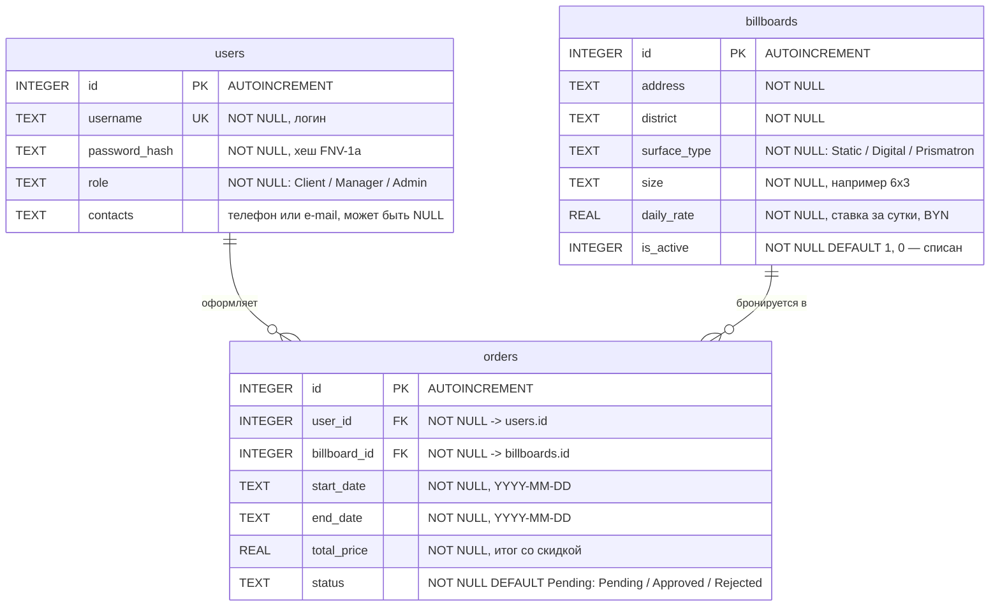

# Хранилище данных AdBoard (SQLite)

Раздел пояснительной записки Разработчика №2. Модуль `include/infrastructure`, `include/repository/DatabaseManager.hpp`,
`src/infrastructure`, скрипт `data/schema.sql` и движок `third_party/sqlite3.c`.

## 1. ER-диаграмма



**Связи:**
* `users` 1 : N `orders` — клиент может оформить много заявок, каждая заявка принадлежит одному клиенту.
* `billboards` 1 : N `orders` — щит может быть забронирован много раз на разные периоды.

Таблица `orders` реализует связь «многие-ко-многим» между клиентами и щитами и при этом хранит
собственные атрибуты связи: период, цену и статус.

## 2. Описание таблиц

### `users` — пользователи системы

| Столбец | Тип | Ограничения | Назначение |
|---|---|---|---|
| `id` | INTEGER | PRIMARY KEY AUTOINCREMENT | Идентификатор |
| `username` | TEXT | NOT NULL, UNIQUE | Логин; уникальность гарантирует база |
| `password_hash` | TEXT | NOT NULL | Хеш пароля (сам пароль не хранится) |
| `role` | TEXT | NOT NULL | `Client`, `Manager` или `Admin` |
| `contacts` | TEXT | — | Телефон или e-mail клиента |

### `billboards` — рекламные конструкции

| Столбец | Тип | Ограничения | Назначение |
|---|---|---|---|
| `id` | INTEGER | PRIMARY KEY AUTOINCREMENT | Идентификатор |
| `address` | TEXT | NOT NULL | Адрес |
| `district` | TEXT | NOT NULL | Район (используется в фильтре) |
| `surface_type` | TEXT | NOT NULL | `Static`, `Digital` или `Prismatron` |
| `size` | TEXT | NOT NULL | Размер поверхности |
| `daily_rate` | REAL | NOT NULL | Базовая ставка за сутки |
| `is_active` | INTEGER | NOT NULL DEFAULT 1 | 1 — в каталоге, 0 — списан |

Щит не удаляется, а **списывается** (`is_active = 0`): иначе внешние ключи заказов указывали бы
на несуществующую строку, и пропала бы история аренды и выручки.

### `orders` — заявки на аренду

| Столбец | Тип | Ограничения | Назначение |
|---|---|---|---|
| `id` | INTEGER | PRIMARY KEY AUTOINCREMENT | Номер заявки |
| `user_id` | INTEGER | NOT NULL, FOREIGN KEY → `users(id)` | Клиент |
| `billboard_id` | INTEGER | NOT NULL, FOREIGN KEY → `billboards(id)` | Щит |
| `start_date` | TEXT | NOT NULL | Начало аренды, ISO `YYYY-MM-DD` |
| `end_date` | TEXT | NOT NULL | Конец аренды (включительно) |
| `total_price` | REAL | NOT NULL | Стоимость с учётом скидки на момент заявки |
| `status` | TEXT | NOT NULL DEFAULT `'Pending'` | `Pending`, `Approved`, `Rejected` |

Даты хранятся в ISO-формате: такие строки сравниваются лексикографически в том же порядке,
что и хронологически, поэтому их можно сортировать и сравнивать без преобразования.

`total_price` сохраняется, а не пересчитывается: если позже изменится ставка щита или правила
скидок, сумма уже оформленной заявки останется той, которую видел клиент.

## 3. Инициализация базы — `DatabaseManager`

1. `sqlite3_open("data/adboard.db")` — открывает файл базы или создаёт его при первом запуске.
2. `PRAGMA foreign_keys = ON` — в SQLite проверка внешних ключей по умолчанию выключена, её
   включают для каждого соединения.
3. Читает `data/schema.sql` целиком и выполняет через `sqlite3_exec`.

Скрипт **идемпотентен** — его можно выполнять при каждом запуске:
* `CREATE TABLE IF NOT EXISTS` не трогает существующие таблицы и данные;
* `INSERT OR IGNORE` с явными `id` добавляет тестовых пользователей и щиты только один раз.

`DatabaseManager` владеет соединением (`sqlite3*`), закрывает его в деструкторе (RAII) и запрещает
копирование, чтобы соединение не было закрыто дважды.

## 4. Паттерн Repository

Ядро системы объявляет интерфейсы `IUserRepository`, `IBillboardRepository`, `IOrderRepository`;
модуль хранения их реализует:

| Интерфейс (ядро) | Реализация (хранилище) | Таблица |
|---|---|---|
| `IUserRepository` | `SqliteUserRepository` | `users` |
| `IBillboardRepository` | `SqliteBillboardRepository` | `billboards` |
| `IOrderRepository` | `SqliteOrderRepository` | `orders` |

**Что это даёт:**
* Сервисы (`AuthService`, `BookingService` …) не содержат SQL и не знают, что данные лежат в SQLite.
  Хранилище можно заменить (файлы, другая СУБД, данные в памяти для тестов), не меняя бизнес-логику —
  это принцип инверсии зависимостей (DIP).
* Весь SQL сосредоточен в одном слое; преобразование строки таблицы в объект выполняется в одном
  месте — `mapRowToBillboard`, `mapRowToOrder`.
* Перечисления C++ хранятся текстом (`"Approved"`, `"Digital"`) и переводятся функциями ядра
  `orderStatusToString` / `orderStatusFromString`, `surfaceTypeToString` / `surfaceTypeFromString`.

**Работа с запросом** (на примере `SqliteOrderRepository::save`):

```cpp
const char* sql = "INSERT INTO orders (user_id, billboard_id, start_date, end_date, total_price, status) "
                  "VALUES (?, ?, ?, ?, ?, ?);";
sqlite3_prepare_v2(db, sql, -1, &stmt, nullptr);         // 1. подготовка запроса
sqlite3_bind_int(stmt, 1, order.getClientId());          // 2. подстановка параметров
...
int rc = sqlite3_step(stmt);                             // 3. выполнение
sqlite3_finalize(stmt);                                  // 4. освобождение
```

Значения передаются **через параметры `?` и `sqlite3_bind_*`**, а не склейкой строк. Поэтому ввод
пользователя (логин, адрес) никогда не становится частью SQL-кода — это защита от SQL-инъекций.
`SQLITE_TRANSIENT` заставляет SQLite скопировать строку, так что временные `std::string` безопасны.

## 5. Целостность данных

| Уровень | Механизм | Пример |
|---|---|---|
| База данных | `PRIMARY KEY`, `NOT NULL`, `UNIQUE`, `DEFAULT` | два пользователя с одним логином не сохранятся |
| База данных | `FOREIGN KEY` + `PRAGMA foreign_keys = ON` | заявка на несуществующий щит или клиента отклоняется |
| Хранилище | подготовленные запросы с параметрами | защита от SQL-инъекций |
| Ядро | проверки в моделях и сервисах | дата окончания не раньше начала, ставка > 0, нет пересечения одобренных заказов |

Каждый запрос в SQLite выполняется **атомарно** (режим автокоммита): строка либо записана целиком,
либо не записана вовсе. Многошаговых операций, которым нужна общая транзакция `BEGIN … COMMIT`, в
системе нет: заявка — одна вставка, решение менеджера — одно обновление статуса.

Бизнес-правило «щит нельзя одобрить на занятые даты» проверяется в `BookingService`, а не в SQL:
это логика предметной области, и её проще тестировать без базы.

## 6. Тестовые данные

| Логин | Пароль | Роль |
|---|---|---|
| `admin` | `admin` | Admin |
| `manager` | `manager` | Manager |
| `client` | `client` | Client |

Плюс три щита: пр. Независимости, 4 (Digital, 60 BYN), пр. Партизанский, 12 (Static, 40 BYN),
ул. Притыцкого, 48 (Prismatron, 50 BYN).
