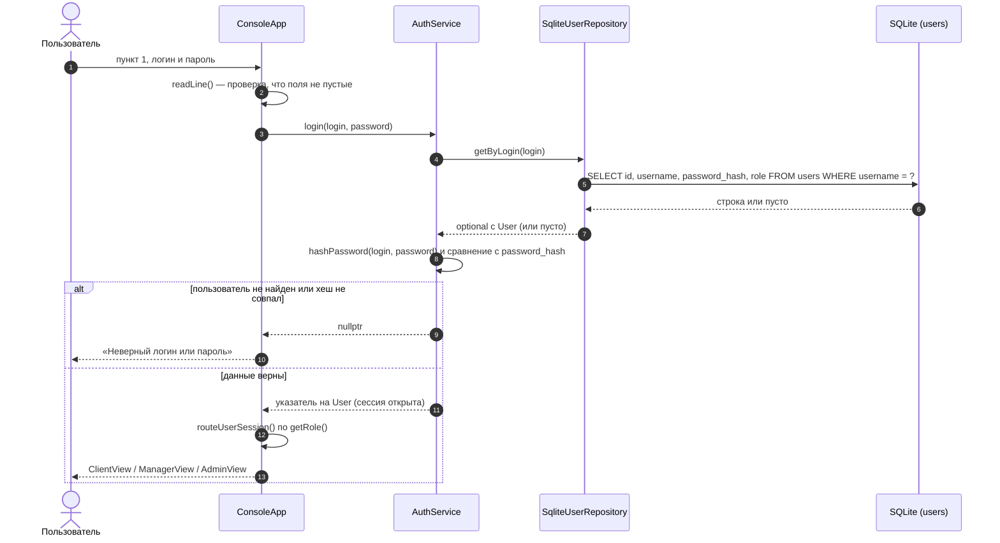
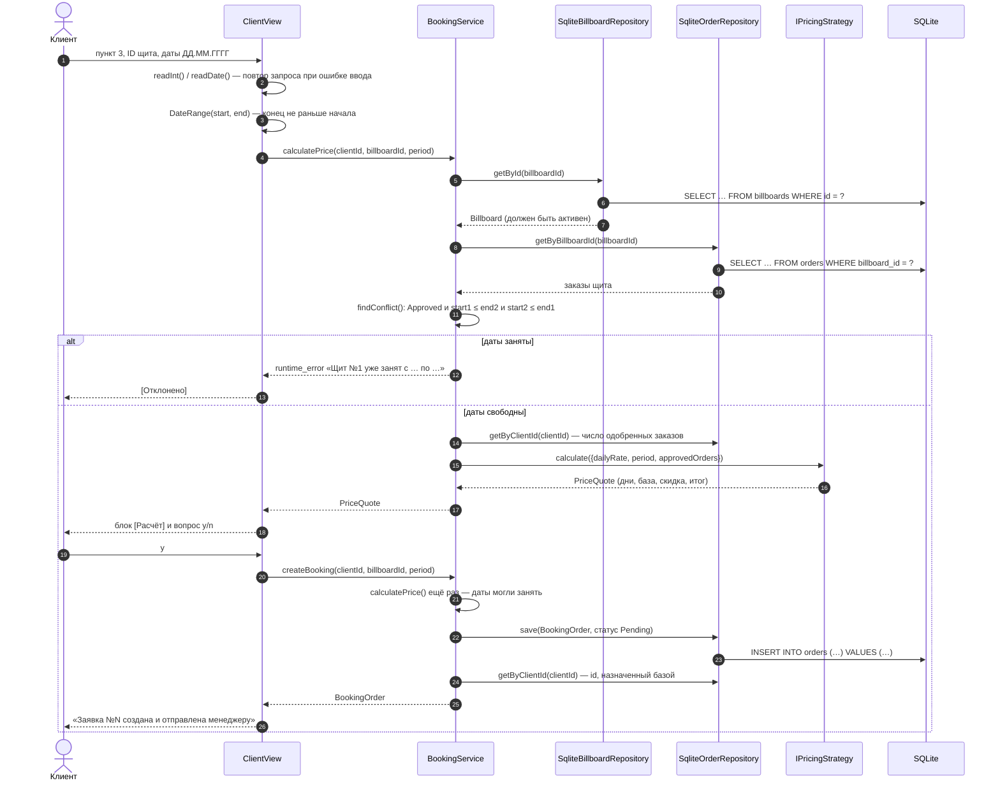
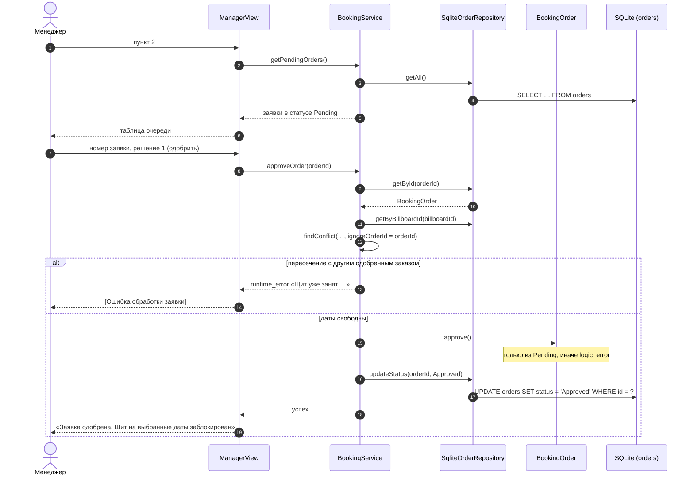
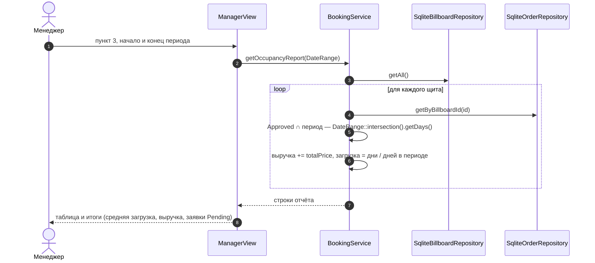

# Диаграммы последовательности AdBoard

Раздел пояснительной записки Разработчика №3. Диаграммы построены по фактическому коду
(`src/ui`, `src/service`, `src/infrastructure`) и показывают, как запрос пользователя проходит
через три слоя: **CLI → сервисы ядра → репозитории SQLite**. Интерфейс не обращается к базе
напрямую — только через сервисы, а сервисы видят лишь интерфейсы репозиториев (`I…Repository`).

## 1. Вход в систему и выбор меню по роли

## 2. Оформление заявки на аренду (клиент)

Ключевой сценарий: расчёт цены через **Strategy** и проверка пересечения дат с одобренными заказами.

## 3. Одобрение заявки менеджером

После одобрения заказ начинает блокировать даты (`BookingOrder::blocksDates()`), поэтому следующая
заявка другого клиента на пересекающиеся даты будет отклонена на шаге `findConflict` диаграммы 2.

## 4. Отчёт по занятости и выручке

